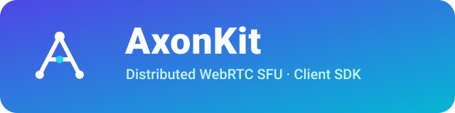

<p align="center">
  
</p>

<p align="center">
  <strong>AxonKit JavaScript/TypeScript client SDK</strong> for real-time communication,<br/>
  built on <a href="https://github.com/versatica/mediasoup-client">mediasoup-client</a> with a
  <a href="https://livekit.io">LiveKit</a>-compatible API surface.
</p>

<p align="center">
  <a href="https://github.com/axonkit/client-sdk-js/actions/workflows/publish.yml"></a>
  <a href="https://www.npmjs.com/package/@axonkit/client-sdk-js"></a>
  <a href="https://www.npmjs.com/package/@axonkit/client-sdk-js"></a>
</p>

## Installation

```bash
pnpm add @axonkit/client-sdk-js
```

## Quick Start

```typescript
import {
  Room,
  RoomEvent,
  ConnectionState,
  setLogLevel,
  LogLevel,
} from '@axonkit/client-sdk-js';

setLogLevel(LogLevel.INFO);

const room = new Room({
  dynacast: true,        // pause simulcast layers with no subscribers
  adaptiveStream: true,  // adapt subscription quality to element size/visibility
});

// Subscribe to events before connecting
room
  .on(RoomEvent.ParticipantConnected, (participant) => {
    console.log(`${participant.identity} joined`);
  })
  .on(RoomEvent.ParticipantDisconnected, (participant) => {
    console.log(`${participant.identity} left`);
  })
  .on(RoomEvent.TrackSubscribed, (track, publication, participant) => {
    const element = track.attach();
    if (track.kind === 'video') {
      document.getElementById('remote-videos')?.appendChild(element);
    } else {
      element.play();
    }
  });

// Connect (token is optional when the server allows anonymous joins —
// pass roomName in RoomOptions instead)
await room.connect('https://your-server.com', 'your-jwt-token');

// Publish camera and microphone
await room.localParticipant.setCameraEnabled(true);
await room.localParticipant.setMicrophoneEnabled(true);

// Later
await room.disconnect();
```

## Features

- **LiveKit-compatible API** — familiar `Room` / `Participant` / `Track` model, events, and options
- **mediasoup-client transport** — WebRTC media over mediasoup send/receive transports
- **DataChannel RPC** — Axon Protocol for signaling over DataChannel after the initial HTTP join
- **Auto Subscribe** — server-side subscription management with no media loss
- **Simulcast / SVC** — simulcast layers, scalability modes, backup codec policies
- **Dynacast** — dynamically pause video encodings with no subscribers
- **Adaptive Stream** — visibility and size-based subscription management
- **Reconnection** — automatic reconnect with pluggable reconnect policy and state sync
- **Data streams & RPC** — sendText/streamText/sendFile/streamBytes and typed RPC between participants
- **Groups** — breakout-room style participant grouping with pin/move
- **Room shared state** — server-backed key/value state with offline catch-up

## API Reference

### Room

| Method | Description |
| --- | --- |
| `connect(url, token?, options?)` | Connect to a room (token optional for anonymous servers) |
| `disconnect(stopTracks?)` | Disconnect and optionally stop local tracks |
| `switchActiveDevice(kind, deviceId)` | Switch camera / microphone / output device |
| `startAudio()` | Resume audio playback (autoplay policy) |

### LocalParticipant

| Method | Description |
| --- | --- |
| `setCameraEnabled(enabled)` | Toggle camera |
| `setMicrophoneEnabled(enabled)` | Toggle microphone |
| `setScreenShareEnabled(enabled)` | Toggle screen share |
| `publishTrack(track, options?)` | Publish a local track |
| `unpublishTrack(track, stopOnUnpublish?)` | Unpublish a track |
| `publishData(data, options?)` | Send data via DataChannel |
| `setMetadata(metadata)` | Update participant metadata |
| `setName(name)` | Update participant display name |

### Events

Subscribe with the `RoomEvent` enum (values are camelCase, matching LiveKit):

```typescript
room.on(RoomEvent.Connected, () => {});
room.on(RoomEvent.Disconnected, (reason) => {});
room.on(RoomEvent.Reconnecting, () => {});
room.on(RoomEvent.ParticipantConnected, (participant) => {});
room.on(RoomEvent.ParticipantDisconnected, (participant, reason) => {});
room.on(RoomEvent.TrackSubscribed, (track, publication, participant) => {});
room.on(RoomEvent.TrackUnsubscribed, (track, publication, participant) => {});
room.on(RoomEvent.ActiveSpeakersChanged, (speakers) => {});
```

Full API documentation is generated with TypeDoc: `pnpm run docs`.

## Building

```bash
pnpm install
pnpm build
```

Outputs:

- `dist/axonkit-client.esm.js` — ES Module
- `dist/axonkit-client.umd.js` — UMD (for `<script>` tags)
- `dist/index.d.ts` — TypeScript declarations

## Demo

Open `examples/demo/index.html` in a browser after building. Requires a running [AxonKit server](https://github.com/axonkit/axonkit).

## License

This SDK is proprietary software licensed exclusively for use with the AxonKit
Service. See [LICENSE](./LICENSE) for the full terms. For commercial inquiries,
contact <jiyeyuran@gmail.com>.
